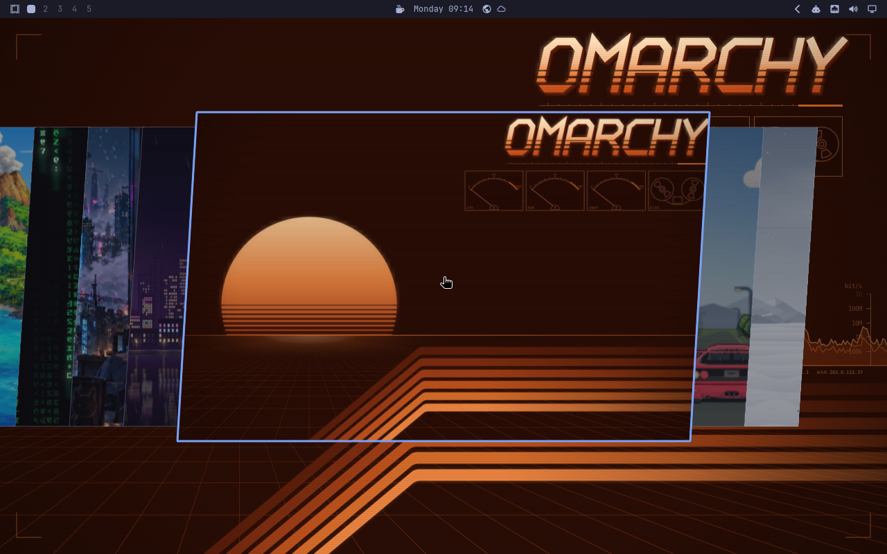

# retro-wall for Omarchy

[retro-wall](https://github.com/PacAnimal/retro-wall)'s live scenes as Omarchy backgrounds: a
synthwave horizon, a rainy neon city, the digital rain, a winter field and more, which move, with the
machine's readings in them. Pick one in the background picker (`Super + Ctrl + W`) and it plays; pick
any other background and it stops.



## How it fits in

- **The background picker.** Each scene is listed with the theme's own backgrounds. It is a still frame of
  the scene: a link in `~/.config/omarchy/backgrounds/<theme>/`, the folder Omarchy keeps for your own
  backgrounds. Choosing it is choosing a background: `omarchy theme bg set`, `bg next`, the picker and
  theme switches all work as they do for any other.
- **The background layer.** While a scene is the background, retro-wall plays it on Wayland's
  background layer, and the shell's own background is suspended, as Omarchy's video engine (OWE)
  suspends it for a video. Any other background stops retro-wall and gives the layer back. The lock
  screen and the bar's colours use the scene's still, as they use any background.
- **Everything stays over it.** The bar, its panels, menus, notifications, the OSD, the dock, the
  picker, the screensaver and the lock screen all draw over the scene. The scene keeps clear of the
  bar, wherever the bar is and whatever its size, on each monitor at its scale.
- **It costs nothing when unseen.** retro-wall pauses while the session is locked, the screensaver
  runs, or every monitor shows a fullscreen window, and it stops drawing on battery. When anything
  but a scene is the background, it is not running at all.
- **Known:** while a scene plays, double-clicking the bare desktop does not open the picker, as with a
  video background in Omarchy 4.5: the shell's click layer is not there while its background is
  suspended. `Super + Ctrl + W` opens it.
- **Nothing of Omarchy's is changed.** It uses Omarchy's own contracts only: the background link, the
  backgrounds folder, `omarchy-shell background setSuspended`, and the plugin interface.

## Install

1. **retro-wall itself.** Download `retro-wall-VERSION-linux-x86_64.tar.gz` from its
   [latest release](https://github.com/PacAnimal/retro-wall/releases/latest), then, in a terminal:

   ```sh
   tar xzf retro-wall-*-linux-x86_64.tar.gz && cd retro-wall-*-linux-x86_64
   linux/install
   ```

   On Omarchy the installer copies the program and its themes to `~/.local/share/retro` and starts
   nothing at login. It then offers to add this plugin through `omarchy plugin add`, which shows
   Omarchy's own warning first.

   Or build the Arch package from the repository:
   `git clone https://github.com/PacAnimal/retro-wall && cd retro-wall/packaging/aur && makepkg -si`,
   then `/usr/lib/retro-wall/linux/install`.

2. **This plugin**, if the installer did not add it:

   ```sh
   omarchy plugin add https://github.com/PacAnimal/omarchy-retro-wall --enable
   ```

3. Open the background picker (`Super + Ctrl + W`) and choose a scene. The scenes are named
   `retro-wall-<scene>`. They are drawn the first time, at your largest monitor's size, which takes
   a few seconds.

Added in the other order, the plugin tells you once that the program is missing, and lists the scenes as
soon as it is installed.

## Options

- **Which scenes are listed:** all of retro-wall's, or only those named in
  `~/.config/retro/omarchy-themes`, one name a line.
- **retro-wall's own options** go in `~/.config/retro/retro-wall.conf`, on the line of your Wayland
  display (`wayland-1` in an Omarchy session), as retro-wall's README says: for example
  `wayland-1  --battery --pause-below 30`. The plugin adds the scene, the monitors and the bar's room
  after them. The instruments' layout and the scenes' settings go in `~/.config/retro/retro.toml`.
- A machine with no hardware OpenGL (a virtual machine) shows the scene's still, not the moving scene,
  unless `--software` is on that line.
- What retro-wall says while it plays is in `~/.local/share/retro/retro-wall.log`.

## Remove

```sh
linux/uninstall        # from the release's directory, or /usr/lib/retro-wall/linux/uninstall
```

It puts the theme's own background back if a scene was shown, removes the scenes from the picker,
the program and its files, and offers to remove the plugin. To keep the program and remove only the
plugin: `omarchy plugin remove io.github.pacanimal.retro-wall`. A scene that is the background then
stays as its still picture.

## Development

`test/vm` installs Omarchy from its ISO into a throwaway virtual machine under QEMU, unattended, and
boots copies of it to test in: `test/vm base omarchy.iso`, `test/vm up`, `test/vm session CMD`,
`test/vm shot FILE`, `test/vm down`. The plugin's file work is `bin/retro-wall-omarchy`; the rest is
`Service.qml`.

## Licence

GPL-3.0-only, as retro-wall.
